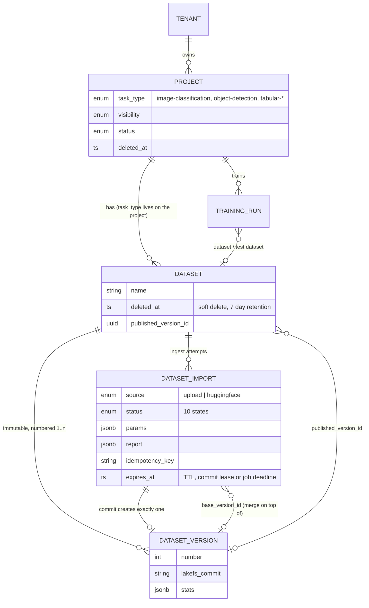
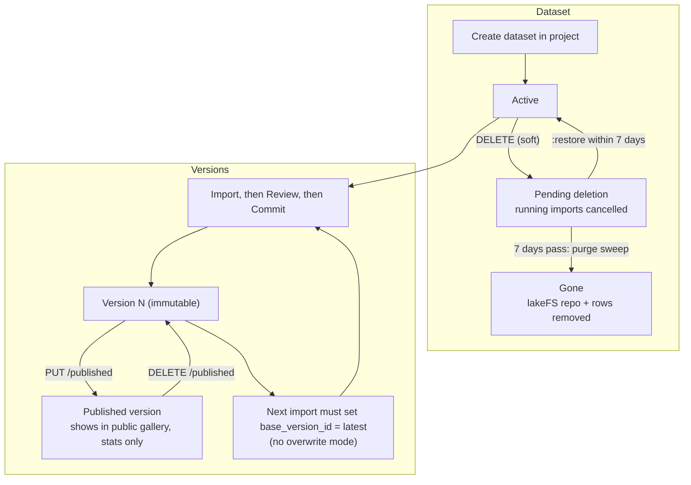
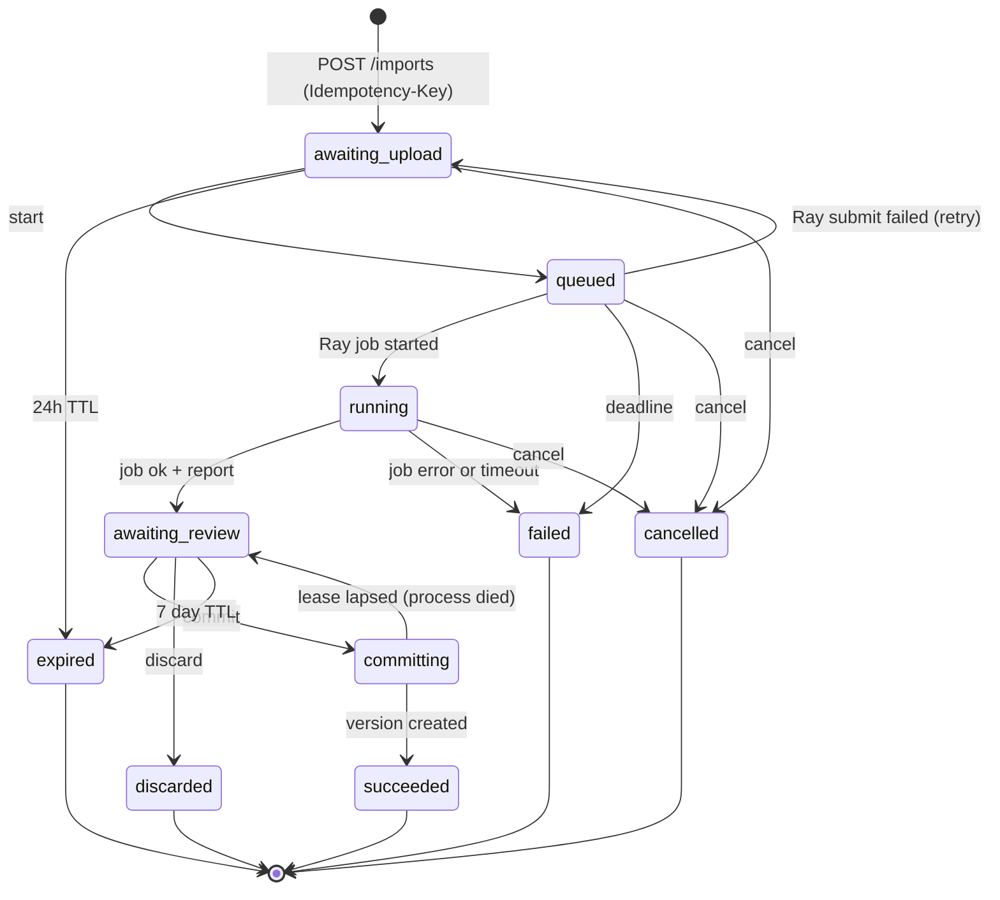
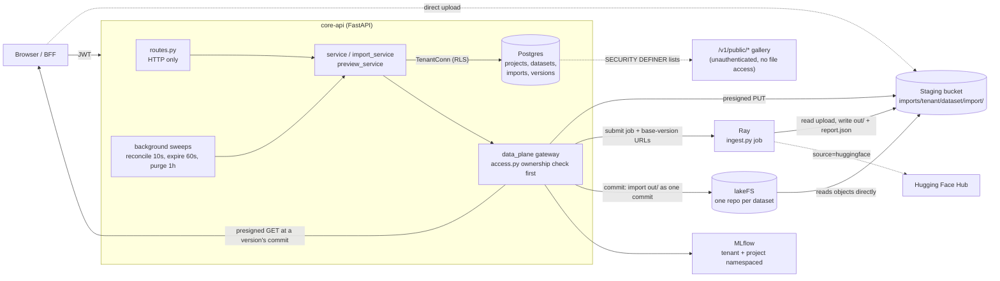
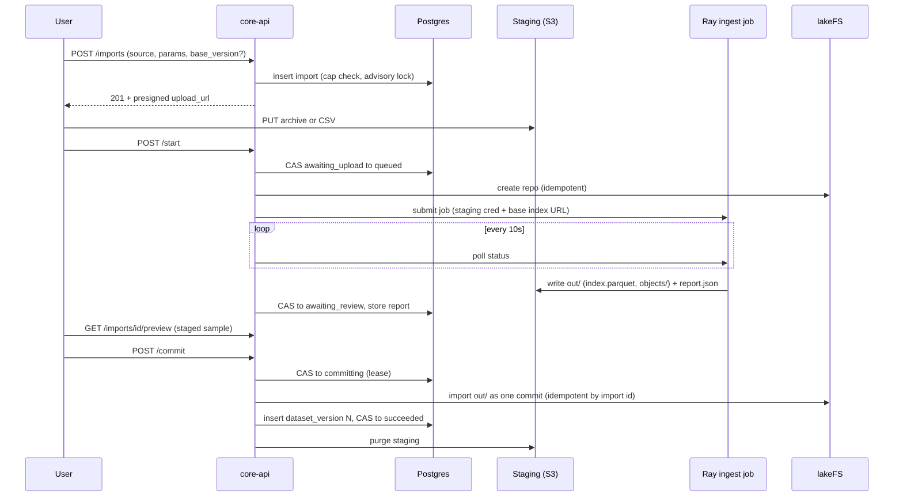

# Datasets: relationships, lifecycle and architecture

How projects and datasets relate, what a dataset and an import go through, and which components do the work.
Decisions and scope are in [datasets-plan.md](datasets-plan.md); the cluster side is in
[runtime-contract.md](runtime-contract.md). The state machine in code is `TRANSITIONS` in
`core-api/app/modules/user/datasets/constants.py`; the staging layout is the docstring of
`core-api/app/integrations/data_plane/layout.py`.

## 1. Project and dataset

A dataset has no task type of its own: it reads the project's, so every dataset in a project holds the same
kind of data. Every table carries `tenant_id` and has row-level security.

## 2. Product lifecycle

### Import state machine

Every arrow is a compare-and-set (`UPDATE ... WHERE status = <from>`), so a retry or a race gets 409 instead of
acting twice. Reusing an `Idempotency-Key` with a different request body is also a 409
(`idempotency_key_reused`).

## 3. Technical architecture

### Import flow end to end

## Design points

- The data-plane gateway is the only code that touches lakeFS, S3 or MLflow, and it checks ownership in Postgres
  first. A foreign id is a 404 before anything outside the database is called.
- File bytes never pass through core-api. Uploads go to staging by presigned PUT, and lakeFS reads staging itself
  on commit.
- The ingest job holds a staging credential and no lakeFS credential.
- The lakeFS commit carries the import id as metadata, so retrying a failed commit returns the commit already made.
- A commit holds a lease (`expires_at` while `committing`); a lapsed lease goes back to review via the expiry sweep
  or the next import's claim.

## Known gaps

- The ingest job's staging credential covers the whole staging bucket, not just its import's prefix. The job parses
  untrusted archives and images, so a parser exploit could read or overwrite other tenants' staged data. Fix:
  per-import STS credentials or presigned URLs for the single prefix. The credential also appears in Ray's
  `runtime_env`.
- Training creation (`POST /training-runs`) returns 501 until the trainer slice rewires it to dataset version ids
  (see Deferred in [datasets-plan.md](datasets-plan.md)).
